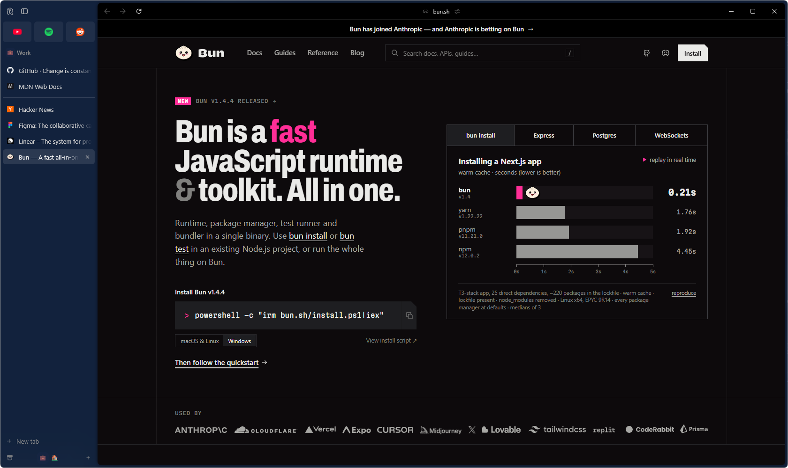

<div align="center">
  
  <h1>Rail</h1>
  <p>A sidebar-first desktop browser built on Chromium.</p>
  <p><a href="https://railbrowser.app">railbrowser.app</a> · <a href="https://railbrowser.app/download">Download for Windows</a></p>
</div>

<p align="center">
  
  
  
  <a href="LICENSE"></a>
</p>

<p align="center">
  
</p>

> [!NOTE]
> Rail is early and Windows-first. macOS and Linux come later; the build is
> already split per platform so a second host only adds a directory.

Yet another Arc-like browser. At least this one is Windows-first.

## What Rail is

A browser built around the vertical tabs experience: tabs, spaces and
navigation live in the sidebar, so the page gets as much of the window as
possible.

The engine is a full Chromium checkout with the ungoogled-chromium patch set.
The product chrome is a privileged WebUI rendered by Chromium itself. Why
WebUI? Because in Chromium, WebUI is native: it is what `chrome://settings`
and `chrome://history` are built with, and Chromium now ships an experimental
browser shell on it, which Rail extends. Tabs, rendering, input, IME,
accessibility, extensions, and process management stay on Chromium's native
paths. It is not Electron, CEF, or a WebView wrapper.

```text
Native Views/Win32 window
└── WebUIBrowserWindow
    ├── chrome://webui-browser/     privileged product shell (the rail)
    └── content region
        └── real WebContents        renderer, GPU, input, AX, IME
```

## Highlights

| Feature | Description |
|---|---|
| **Spaces** | Separate contexts with their own color, icon and tabs. Switch with a shortcut, reorder by drag. |
| **Profile per space** | A space can run on its own Chromium profile: cookies, logins and extensions stay apart. |
| **Favorites and pinned rows** | Favorites sit on top and span every space; pinned rows belong to one space and reopen at their home URL. |
| **Folders and tab groups** | Collapsible folders inside a space, plus tab groups mirrored from Chromium's own. |
| **Tab trails** | Tabs opened from a link nest under their opener, with a way back to it. |
| **Sleep and archive** | Idle tabs sleep to free memory, stale ones move to a restorable archive instead of vanishing. |
| **Command bar** | `Ctrl+T`, `Ctrl+L` or `Ctrl+K`: one input for URLs, search, open tabs, history and browser commands. |
| **Library** | Downloads, spaces and archived tabs in one place. |
| **Site-colored top bar** | The thin bar above the page takes the page's own color. |
| **Site panel** | Permissions, extensions and the link for the current site, behind the address. |
| **Mini window** | Links opened from other apps land in a small window first and become a tab only if you want. |
| **Content blocking** | uBlock Origin ships preinstalled. |
| **Windows native** | Mica and acrylic backdrops, system-style window controls. |

## Privacy

Rail inherits ungoogled-chromium, which strips Google's background services
from the engine: no browser sign-in or sync, no usage and crash reports, no
field-trial header on requests, and no Safe Browsing lookups.

A few things are turned back on because a daily browser needs them, and each
is visible and yours to change:

- Google is available in the search engine list, and search suggestions are on,
  so what you type in the command bar goes to the search engine you picked.
- Extensions install from the Chrome Web Store.
- uBlock Origin ships preinstalled and blocks ads and trackers from the first
  launch.
- Tidy, which groups tabs with an AI model, is bring-your-own-key (BYOK): it
  stays off until you add your own OpenRouter API key, which is stored
  encrypted in your profile, and only then sends tab titles and site domains to
  the model you choose.

## Quick start

Windows 11 with Visual Studio's C++ toolchain.

```powershell
python -m venv .venv
.\.venv\Scripts\python.exe -m pip install -r requirements-dev.txt
.\.venv\Scripts\python.exe .\build.py --prepare-only --7z-path "C:\Program Files\7-Zip\7z.exe"
.\.venv\Scripts\python.exe .\build.py --dev --reuse --target chrome -j 20
.\scripts\run.ps1 -FreshProfile
```

The first build takes hours. Later builds are incremental.

## Layout

```text
build.py                      build driver, resolves platform/<host>
src/                          Rail's own WebUI and native files
patches/                      Rail's own patches, applied on every platform
  series                        order of the product layer
platform/windows/             everything that only matters on Windows
  patches/ungoogled/            Windows patches from upstream
  patches/toolchain/            local toolchain fixes
  flags.dev.gn                  GN config for local iteration
  flags.release.gn              GN config for distribution builds
  downloads.ini, revision.txt   pinned Chromium version
  pruning.list, domain_substitution.list
  clone.py, package.py
scripts/run.ps1               launch the local build
ungoogled-chromium/           submodule: core ungoogled patch set
build/                        untracked: Chromium checkout and build output
```

Patches apply in three layers: the ungoogled submodule set, then
`platform/<host>/patches`, then `patches/`. A second platform adds a
`platform/<name>/` directory and nothing else moves.

The path `build/src` is frozen. Relocating the project directory invalidates the
entire build cache and costs a full rebuild.

## Attribution and license

Rail's build system is derived from `ungoogled-chromium-windows` and depends on
`ungoogled-chromium`. See `NOTICE.md`. Licensed under the terms in `LICENSE`.
uBlock Origin is distributed under GPLv3; see `THIRD_PARTY.md`.
